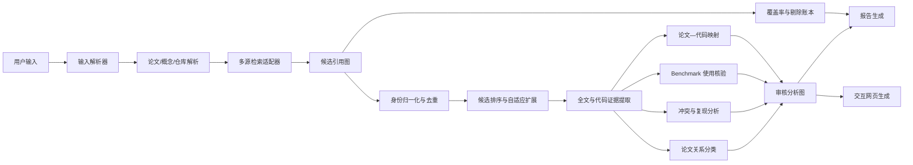

# Academic Research Graph Skill：设计说明

## 1. 设计目标

这个 Skill 面向三类入口：

1. 一篇具体论文；
2. 一个具体概念、论点、方法或 Benchmark；
3. 一个与论文有关的 GitHub 仓库。

它的目标不是生成普通的“相关论文列表”，而是构建一个**证据可追溯的学术演化网络**：既能向前追踪来源，也能向后追踪后续工作；既能描述论文之间的继承和改进，也能识别批评、冲突、复现失败与条件性结论；对于代码仓库，还要把论文中的方法映射到实际代码。

最终交付包括：

- 研究综述报告；
- 候选论文全集账本；
- 经过深读和证据审查的论文关系图；
- 冲突与 Benchmark 使用证据；
- GitHub 代码—论文映射；
- 可交互的节点—边网页。

## 2. 为什么不能只做“引用爬取”

引用关系本身很弱。同一条引用可能只是：

- 背景介绍；
- 使用了方法；
- 使用了 Benchmark；
- 作为比较基线；
- 批评或反驳；
- 延伸或替代；
- 仅仅出现在综述性段落中。

因此本 Skill 内部维护两张图：

### 2.1 候选引用图

尽可能广泛地收集：

- 论文引用的工作；
- 引用论文的工作；
- 二级、三级或更高级引用；
- 相关论文；
- 共同使用概念、方法、Benchmark、数据集或仓库的论文；
- 时间上最新的论文。

这张图主要用于保证覆盖率，不要求每条边都经过深读。

### 2.2 审核分析图

只保留经过证据确认的节点和边。每条重要边必须回答：

- 两篇论文在当前核心问题下到底是什么关系？
- 新论文继承了什么？
- 修改或改善了什么？
- 证据在哪里？
- 关系判断的置信度是多少？

最终网页默认展示审核分析图，而不是噪声很大的候选图。

## 3. 总体架构



## 4. 核心模块

### 4.1 输入解析器

#### 论文入口

支持：

- 标题；
- DOI；
- arXiv ID 或 URL；
- OpenAlex ID；
- Semantic Scholar Corpus ID；
- 出版商页面；
- 用户提供的 PDF。

解析后得到统一的种子论文记录，并关联预印本、会议版、期刊版、勘误或扩展版。

#### 概念、论点与 Benchmark 入口

一个概念的“来源”可能有多种定义：

- 第一次出现该术语；
- 第一次给出正式定义；
- 第一次实现该方法；
- 第一次给出关键实验；
- 第一次使其广泛流行。

因此 Skill 不强行寻找唯一“第一篇”，而是先构造多个来源候选，再分类说明它们分别承担了什么历史角色。

#### GitHub 仓库入口

按以下顺序反查论文：

1. `CITATION.cff`、`codemeta.json`；
2. README 中的 DOI、arXiv、BibTeX 或论文链接；
3. Zenodo、论文或会议徽章；
4. 文档、发布说明和包元数据；
5. 仓库名、作者、组织与方法名匹配；
6. 搜索包含仓库名或独特代码符号的论文。

若存在多个候选论文，则保留排序结果和匹配证据，不静默选择。

### 4.2 多源检索适配层

推荐职责分工：

- **OpenAlex**：广覆盖引用骨架、被引论文、参考文献、相关工作、主题与开放获取信息；
- **Semantic Scholar**：引用/参考文献交叉核对、论文匹配、摘要和语义信息；
- **Crossref**：DOI 归一化、出版元数据、更新、许可和引用元数据；
- **arXiv**：预印本、版本历史、类别和开放全文；
- **出版商/会议网站**：权威版本、补充材料和勘误；
- **GitHub**：代码、版本、提交、发布、Issue 与配置。

不同来源的引用计数必须分别保留，不能默默求平均值。

### 4.3 身份归一化

论文去重的优先级：

1. DOI；
2. arXiv ID；
3. Semantic Scholar Corpus ID；
4. OpenAlex ID；
5. PMID/PMCID；
6. 标题、作者和年份的高置信匹配。

预印本与出版版通常合并为一个“版本族”，但保留各自日期和链接。如果会议版与期刊扩展版的内容显著不同，则作为不同节点并建立版本关系。

### 4.4 自适应引用扩展

不能固定“只查两级”或“总查五级”。应根据分支价值动态扩展。

优先继续扩展的论文：

- 与核心问题高度相关；
- 连接两个重要研究分支；
- 提出新的命名变体；
- 引入或真正使用 Benchmark；
- 包含批评、负面结果或复现失败；
- 是时间上最新且有实质增量的工作；
- 被多个已确认的核心论文共同引用。

停止某一分支的条件：

- 新一轮检索中，新增相关论文比例低于 10%；
- 大部分引用只是背景或无关应用；
- 已偏离用户的核心问题；
- 达到候选预算。

### 4.5 候选排序

默认评分：

| 因素 | 权重 |
|---|---:|
| 与核心问题的相关度 | 0.30 |
| 在演化链路中的重要性 | 0.15 |
| 跨分支桥接性 | 0.12 |
| 方法创新性 | 0.12 |
| 冲突或批评概率 | 0.10 |
| Benchmark/仓库证据价值 | 0.08 |
| 最新前沿价值 | 0.08 |
| 当前可获得证据质量 | 0.05 |

引用数只能作为辅助信号，必须考虑论文年龄，避免把新论文全部排到后面。

### 4.6 全文证据提取

每篇深读论文只围绕当前核心问题提取：

- 解决的问题；
- 主要贡献；
- 继承的组件；
- 修改的组件；
- 数据、Benchmark 和实验协议；
- 关键结果；
- 限制；
- 对前作的明确评价；
- 代码与数据可用性。

证据分级：

- `direct`：论文正文、表格、图、实验或代码明确支持；
- `strong_indirect`：多项证据高度一致，但没有直接表述；
- `inferred`：分析者推断，必须显式标注；
- `unsupported`：不进入审核分析图。

### 4.7 论文关系语义

审核边可以包含多种关系，例如：

- 引入概念或 Benchmark；
- 正式化；
- 延伸方法；
- 修改架构；
- 提高效率；
- 改善数据需求；
- 应用方法；
- 使用 Benchmark；
- 使用数据集；
- 比较基线；
- 复现或复现失败；
- 批评、矛盾或支持；
- 替代或超越；
- 综述整合；
- 独立并行发现；
- 官方仓库、实现或代码偏离论文。

边的方向需要同时保留“概念演化方向”和“实际引用方向”，避免图示产生歧义。

### 4.8 冲突分析

冲突必须落到具体 Claim，而不是笼统地说“两篇论文观点不一致”。

比较维度：

- 研究问题；
- 适用范围；
- 假设；
- 数据集和划分；
- 指标；
- 基线实现；
- 模型和计算规模；
- 统计方法；
- 代码、数据或模型版本。

冲突类型：

- 直接冲突；
- 适用范围不同；
- 测量或指标不同；
- 版本变化；
- 对同一现象的解释不同；
- 复现失败；
- 只有批评而没有实证矛盾；
- 后续工作已经调和或解决。

最终报告需要说明：冲突是真实的、条件性的，还是只是表面差异。

### 4.9 Benchmark 使用核验

引用 Benchmark 论文不等于真正使用 Benchmark。必须至少确认一项：

- 实验部分明确使用；
- 表格或图中报告 Benchmark 结果；
- 代码加载了 Benchmark 数据集或评估器；
- 运行了官方评估脚本；
- 指标与官方协议可直接比较。

使用类型：

- 官方协议；
- 修改后的协议；
- 只用部分子集；
- 仅受其启发；
- 只提到但没有使用；
- 无法确认。

必须记录版本、划分、指标、评估器和协议偏差。

### 4.10 GitHub 代码分析

代码分析必须固定到 commit SHA，避免“今天看到的代码”与论文发表时的代码混为一谈。

重点分析：

- 安装与复现命令；
- 训练、推理和评估入口；
- 模型组件；
- 数据管线；
- 默认配置；
- Checkpoint；
- 测试；
- 发布版本；
- Issue 中的已知问题；
- 论文发表后的重要修改。

论文—代码映射表：

| 论文内容 | 代码位置 | 实现状态 |
|---|---|---|
| 某个公式/算法步骤 | 文件、类、函数和行号 | 精确 / 近似 / 修改 / 缺失 / 不清楚 |

应重点指出：论文没有写明、但实际影响结果的工程技巧；以及论文与代码默认配置之间的差异。

## 5. 图谱数据模型

### 节点

支持：

- paper；
- concept；
- benchmark；
- dataset；
- repository。

论文节点包含：

- 标题、作者、时间、Venue 和状态；
- DOI、arXiv、OpenAlex、Semantic Scholar 等标识符；
- 与核心问题相关的总结；
- 在链路中的角色；
- 集群；
- 相关度与启发式质量评分；
- 是否为种子或最新前沿；
- 链接、Claim 和证据 ID。

### 边

包含：

- 起点与终点；
- 一个或多个关系类型；
- 主要关系；
- 解释；
- 证据等级；
- 置信度；
- 是否属于主链路；
- 是否为冲突；
- 冲突类型；
- 证据 ID；
- 实际引用方向。

## 6. 主链路的选择

主链路不是“引用数最高的路径”，而是最能解释当前问题的概念继承路径。

例如分析 ViT 时，主链路可能是：

Transformer → ViT → 数据效率改进 → 层次化结构 → 自监督或多模态前沿。

同时还可以有：

- 卷积网络反驳与替代解释；
- 密集视觉任务分支；
- 高效推理分支；
- 大规模预训练分支。

对于 Transformer 这类基础工作，应构造多个命名主链路，而不是试图画出唯一的一条线。

## 7. 工作量控制

### Quick

- 1–2 跳；
- 约 80 个候选；
- 深读 15–30 篇。

### Standard

- 自适应 2–3 跳；
- 约 300 个候选；
- 深读 40–90 篇。

### Deep

- 3 跳以上；
- 最多约 1000 个候选；
- 深读 80–180 篇；
- 强化分支搜索与覆盖率核查。

### Foundational

适用于 Transformer、扩散模型等基础主题：

- 不逐篇深读全部引用；
- 先聚类；
- 每个集群选择代表论文、桥接论文、争议论文和最新论文；
- 给出聚合统计和剔除账本。

## 8. 可视化页面

附带的 `render_site.py` 使用原生 SVG 和 JavaScript，生成单文件 HTML，不依赖前端构建系统。

交互能力：

- 点击节点查看论文元数据、内容总结、角色、链接和 Claim；
- 点击边查看关系解释、证据等级和冲突类型；
- 按标题、作者、角色搜索；
- 按关系、集群和最低相关度过滤；
- 只显示主链路；
- 只显示冲突分支；
- 缩放、拖动和自动布局。

视觉编码：

- 粗边：主链路；
- 红色虚线：冲突或批评；
- 蓝色边：Benchmark 或数据集；
- 紫色边：代码仓库；
- 强调边框：种子节点；
- 前沿标记：最新重要工作。

颜色之外还使用线宽、虚线和文字标签，避免只依赖颜色传达含义。

## 9. 可信度与覆盖率审计

最终报告必须包含：

- 使用了哪些检索来源；
- 检索截止日期；
- 总候选数；
- 深读数；
- 审核图节点和边数量；
- 剔除数量与理由；
- 只有摘要、没有全文的论文；
- 身份无法完全确认的论文；
- 引用数据库之间的差异；
- 仓库分析所用 commit；
- 无法充分裁定的冲突。

允许说：

> 截至某日，在所查询的 OpenAlex、Semantic Scholar 等来源中发现的全部引用工作。

不应说：

> 世界上所有引用这篇论文的文章。

## 10. 包内文件

```text
academic-research-graph-skill/
├── SKILL.md
├── DESIGN.zh-CN.md
├── README.md
├── config/defaults.yaml
├── schemas/
│   ├── input.schema.json
│   ├── graph.schema.json
│   ├── expansion_request.schema.json
│   └── graph_patch.schema.json
├── tasks/
│   ├── 01_resolve_input.md
│   ├── 02_retrieve_candidate_graph.md
│   ├── 03_normalize_and_rank.md
│   ├── 04_read_and_extract.md
│   ├── 05_conflict_analysis.md
│   ├── 06_benchmark_and_repo.md
│   ├── 07_render_and_audit.md
│   └── 08_expand_from_node.md
├── prompts/
├── adapters/README.md
├── templates/research_report.md
├── scripts/
│   ├── init_run.py
│   ├── rank_candidates.py
│   ├── validate_graph.py
│   ├── init_expansion.py
│   ├── merge_expansion.py
│   └── render_site.py
└── examples/
    ├── sample_request.yaml
    ├── sample_graph.json
    └── sample_index.html
```

## 11. 后续工程化方向

当前包完整定义了研究方法、数据契约、验证和页面渲染。真正部署时，可继续增加：

- OpenAlex、Semantic Scholar、Crossref、arXiv、GitHub 的具体适配器；
- 本地缓存与断点续跑；
- PDF 结构化解析和引用上下文定位；
- 图聚类与桥接中心性计算；
- 针对超大主题的分层图；
- 人工审核界面；
- 定期增量检索与“最新引用”更新。

## 12. 从已有节点继续调研的增量机制

用户可以在当前审核图中选择任意节点，将它作为**局部种子**继续调研。这个操作不会把原图重新生成一遍，也不会改变原始种子，而是创建一个有版本记录的局部分支。

### 12.1 增量调研请求

请求至少包含：

- 原图 `graph_id` 与 `revision`；
- `start_node_id`；
- 本次局部问题；
- 扩展方向：向前、向后、双向、相关工作、冲突、Benchmark 使用或代码仓库；
- 深度和候选/深读预算；
- 输出语言。

页面中的节点详情提供“继续调研此节点”入口，并导出 `expansion_request.json`。静态网页本身不联网；宿主 Agent 读取请求后执行检索。

### 12.2 局部分支研究

扩展时优先利用原有候选账本和证据，避免重复检索。候选排序同时考虑：

1. 对选中节点和本次局部问题的相关度；
2. 对原图产生的新信息量。

高价值增量包括：新增研究链路、连接原有集群、改变既有关系解释、发现冲突、补足 Benchmark 使用证据、找到新代码版本或更新最新前沿。

### 12.3 Patch 而非直接覆盖

调研结果先写入 `graph_patch.json`：

- 新增或更新节点；
- 新增或更新边；
- 冲突和集群更新；
- 本次检索来源、截止日期和证据；
- 主链路是否需要重评。

合并工具验证原图版本和节点身份后再生成新 revision。默认只追加或修订，不删除；旧图保存到 `history/`，因此每一次解释变化都可追踪。

### 12.4 合并后的可视化

更新后的页面继续展示整张图，并支持：

- 高亮最新 revision 新增的节点和边；
- 只查看本次增量；
- 查看某节点由哪次扩展加入或更新；
- 再次从任意节点发起下一轮扩展。

## 13. 中文与多语言输出

Skill 将检索语言和输出语言分开。论文来源可以主要是英文，但报告仍可完整使用中文。

### 13.1 `zh-CN`

以下内容必须使用简体中文：

- 研究报告；
- 节点的面向“本领域相关但未读过论文”读者的结构化导读；
- 节点的焦点相关摘要和角色说明；
- 边的关系解释；
- 冲突裁定；
- 覆盖率、局限和增量报告；
- 页面 UI。

论文原始标题、作者、Venue、DOI、arXiv ID、Benchmark 名、指标、代码路径、类名和函数名保持原文。需要时另设 `titles.zh-CN`，不能用译名覆盖可检索的正式标题。

### 13.2 `bilingual`

双语模式使用语言映射保存内容，例如：

```json
{
  "summary": "兼容字段",
  "summaries": {
    "zh-CN": "中文分析",
    "en": "English analysis"
  }
}
```

页面按确定规则切换或并列显示，不能把两种语言随机混写。

### 13.3 术语一致性

运行级 `terminology_glossary` 记录技术术语译法。中文首次出现时可以写作“移位窗口（shifted window）”，之后保持统一。涉及争议的原始 Claim 应保留原文并附中文解释，以免翻译抹平限定词、否定或语气强度。
## 14. 发表状态、Venue 与顶会标记

论文节点不再只保存一个模糊的 `venue/status` 字符串，而是保存结构化 `publication`：

- `status`：`preprint_only`、`under_review`、`accepted`、`published` 等；
- `type`：预印本、会议论文、期刊论文、Workshop 论文等；
- `primary_venue`：正式发表的会议或期刊；
- `versions`：arXiv 预印本、会议版、期刊扩展版等版本记录；
- `peer_reviewed`：是否经过同行评审。

节点详情页明确显示“仅预印本”或“会议论文 · 会议名 / 期刊论文 · 期刊名”，并列出预印本与正式版本。

“顶会”不是跨学科、永久不变的事实。只有当节点记录 `primary_venue.tier = top`，并同时记录 `tier_basis` 和 `tier_as_of` 时，页面才显示醒目的“★ 顶会”标记。判定依据可以是用户指定名单、机构认可规则或明确的学科榜单；Skill 不应依靠一个不可追溯的硬编码全局名单。Venue 级别只作为质量背景，不替代对方法、证据与复现性的评价。

## 15. 初始图与增量高亮的边界

初次建图的 revision 1 是**基线**，不是一次“增量”。因此：

- 初始页面不显示“只看本次增量”；
- 图例中不显示“本次新增/更新”；
- 所有初始节点和边不使用增量描边或虚线；
- 节点和边详情不显示无意义的“加入版本 1 / 更新版本 1”。

只有 `merge_expansion.py` 完成真实的节点扩展、写入 `expansion_history` 与 `meta.latest_increment`、并生成 revision 2 或更高版本后，页面才启用增量高亮。这样“本次新增/更新”始终指向最近一次扩展，而不是整张初始图。


## 论文内容导读的默认读者模型（v0.2.2）

论文节点的长篇概括不再假定读者已经读过原文。默认读者是：了解该领域的基础背景，但完全不知道这篇论文的具体问题设定、术语、架构、实验和结论的人。

因此，论文节点应同时保存两种不同用途的文本：

1. `summary`：一句或一段简短文字，说明论文与当前核心问题和研究链路的关系；
2. `reader_summary`：能够独立阅读的论文导读，依次说明背景、问题、核心思路、主要发现、重要性和局限，并在需要时解释论文特有概念。

`reader_summary` 的最低结构为：

```json
{
  "audience": "field_familiar_unread",
  "zh-CN": {
    "background": "论文出现前，这一方向通常怎样做，为什么仍有问题。",
    "problem": "论文具体要解决的约束或争议。",
    "approach": "核心机制及主要组件分别做什么。",
    "key_findings": ["带比较对象和实验条件的结果。"],
    "why_it_matters": "它如何改变当前研究链路。",
    "limitations": ["假设、适用边界、尚未验证之处。"],
    "concepts": [
      {"term": "论文特有术语", "explanation": "无需阅读原文也能理解的定义。"}
    ]
  }
}
```

质量判断不再是“是否把摘要压缩得足够短”，而是：一个本领域同行在没有打开 PDF 的情况下，能否说清论文为何提出、怎样工作、证据是什么、结果在什么条件下成立，以及不能据此推出什么。

中文表达应避免只堆叠英文组件名或名词短语。首次出现的缩写和论文特有术语需要解释；“更好”“更高效”“更深”等比较必须指出相对于什么基线、在哪个指标或数据条件下。类比可以帮助建立直觉，但不能替代实际机制和实验条件。


## 论文主图与解释性视觉资产（v0.2.3）

论文节点可以酌情包含一个 `featured_figure`，用于降低首次阅读门槛并改善详情面板的观感。它不是论文封面，也不是每篇论文必须填写的装饰字段。选择标准是：读者在没有阅读全文的前提下，是否能借助这张图更快理解论文的核心机制、系统流程、结构差异或关键现象。

优先顺序通常是方法总览、架构图、端到端流程、概念示意和能够直接展示核心贡献的定性结果。只有在图仍然清晰且性能比较本身就是核心论点时，才选择结果汇总图。密集表格、普通训练曲线、泛化的数据样例和需要依赖大量正文才能解释的多面板图不应仅为美观而加入。

每张图必须记录：

- 原论文版本、图号或页码；
- 可追溯的来源 URL 与引用文本；
- 版权许可或使用依据；
- 本地资源路径、MIME 类型与可选哈希；
- 面向辅助技术的替代文本；
- 面向未读论文者的读图提示；
- 为什么选择这张图，而不是其他图。

页面优先嵌入 `assets/figures/` 下经过压缩的本地图像，从而保持单文件 HTML 可携带。默认不静默热链远程图片。无法合理展示原图时，可以不放图；也可以制作明确标注为“分析者示意重绘”的原创示意图，但不得让用户误以为它来自论文。

增量调研中的图像资源随 `graph_patch.json` 一起放在扩展目录。合并脚本只复制扩展目录内的安全相对路径，并在目标文件冲突时改名，避免覆盖旧图或读取任意系统文件。
